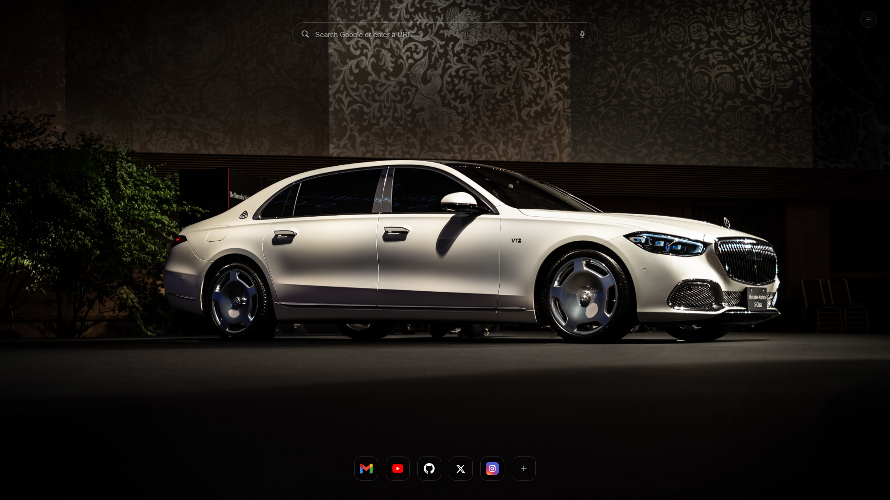
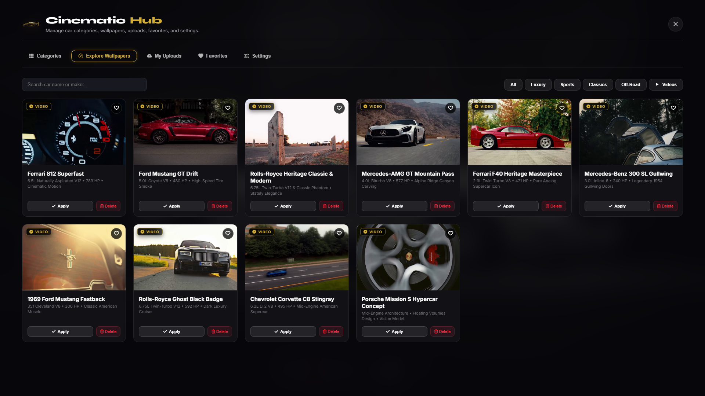
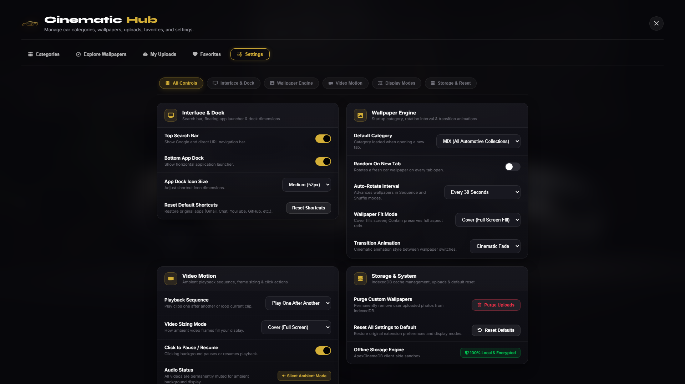

<p align="center">
  
</p>

<h1 align="center">Apex Cinema — Cinematic New Tab</h1>

<p align="center">
  <strong>Ultra-Luxury Automotive Backdrops • Ambient 16:9 Motion • Minimalist App Dock • Transparent Search</strong>
</p>

<p align="center">
  
  
  
  
  
</p>

---

## Overview

**Apex Cinema** transforms Google Chrome's standard new tab into an aesthetic, distraction-free automotive dashboard. Say goodbye to cluttered news feeds, clickbait widgets, and sponsored cards — enjoy ultra-crisp automotive photography and silent widescreen motion backgrounds every time you open a tab.

<p align="center">
  
</p>

---

## Key Highlights & Features

| Capability | Technical Description | Status |
|---|---|:---:|
| **Cinematic Video Engine** | Native 16:9 widescreen video loops with audio stripped (`-an`) for silent ambient motion. |  |
| **Client-Side Acceleration** | Pre-decodes upcoming wallpapers directly into GPU memory via `ImageOptimizer` with zero flash. |  |
| **Strict Category Isolation** | Photos and Videos are strictly segregated; MIX category exclusively cycles still photos. |  |
| **Memory & Category Persistence** | Remembers selected category across tab reloads and browser restarts without resetting. |  |
| **Transparent Omnibox Search** | Floating transparent search bar with Google queries, direct URL navigation, and speech input. |  |
| **Desktop-Style App Dock** | Sleek floating launcher with pre-configured icons (**Gmail**, **YouTube**, **GitHub**, **X**, **Instagram**). |  |
| **One-Touch Bookmarking** | Instant favorite toggle via keyboard hotkey with a dedicated offline Favorites gallery. |  |
| **100% Local & Private** | Zero analytics, zero telemetric logging, zero external dependencies. |  |

---

## Visual Showcase & Interface Tour

<div align="center">

### Main Dashboard
*Minimalist interface featuring the floating transparent search bar, official brand dock, and high-resolution automotive imagery.*
<br>


<br><br>

### Slide-Over Cinematic Hub
*Switch between Luxury, Sports, Classic, Off-Road, and Videos with independent rotation and display modes.*
<br>


<br><br>

### Explore Gallery & Ambient Motion
*Browse high-definition video backgrounds with live preview thumbnails, technical engine specs, and cine camera metadata.*
<br>


<br><br>

### Granular Configuration Engine
*Fine-tune rotation intervals (10s to 15m), wallpaper fit mode, dock icon sizes, and offline database storage.*
<br>


</div>

---

## Curated Machine Collection

<details open>
<summary><b>Cinematic Video Backgrounds (Dedicated Category)</b></summary>
<br>

All video backgrounds are rendered in 16:9 widescreen landscape with audio tracks permanently stripped for silent, non-intrusive viewing:

- **Ferrari 812 Superfast** — *6.5L Naturally Aspirated V12 • 789 HP*
- **Ferrari F40 Heritage Masterpiece** — *2.9L Twin-Turbo V8 • 471 HP*
- **Porsche Mission S Hypercar Concept** — *Vision Model • Floating Volumes Architecture*
- **Chevrolet Corvette C8 Stingray** — *6.2L LT2 V8 • 495 HP • Mid-Engine American Supercar*
- **Ford Mustang GT Drift** — *5.0L Coyote V8 • 480 HP • High-Speed Tire Smoke*
- **1969 Ford Mustang Fastback** — *351 Cleveland V8 • 300 HP • Classic American Muscle*
- **Rolls-Royce Heritage Classic & Modern** — *6.75L Twin-Turbo V12 & Classic Phantom*
- **Rolls-Royce Ghost Black Badge** — *6.75L Twin-Turbo V12 • 592 HP • Dark Luxury Cruiser*
- **Mercedes-AMG GT Mountain Pass** — *4.0L Biturbo V8 • 577 HP • Alpine Ridge Canyon Carving*
- **Mercedes-Benz 300 SL Gullwing** — *3.0L Inline-6 • 240 HP • Legendary 1954 Gullwing Doors*

</details>

<details>
<summary><b>Still Photography Wallpapers</b></summary>
<br>

- **Luxury Cars:**
  - Mercedes-Maybach S 580 4MATIC
  - Mercedes-Maybach SL 680 Monogram
  - Maserati GranTurismo Trofeo
- **Sports Cars:**
  - Porsche 911 Turbo S & Carrera GTS & Carrera T
  - Porsche 911 GT3 (Alpine Snow Edition)
  - Porsche 911 Sport Classic (Front View & Profile View)
  - Ferrari F8 Tributo & Portofino M
  - Mercedes-Benz SLS AMG Gullwing
  - BMW M4 Convertible & BMW M4 Competition G82 Green
- **Classic Cars:**
  - 1967 Shelby Mustang GT500
  - 1965 Shelby Mustang GT350
- **Off-Road & SUVs:**
  - Land Rover Defender 110 X
- **MIX Category:**
  - Dynamically rotates all verified photography without duplicates.

</details>

---

## Keyboard Shortcuts

| Shortcut | Action |
|:---:|---|
| <kbd>/</kbd> | Instantly focus the transparent search bar |
| <kbd>→</kbd> | Advance to next wallpaper or video |
| <kbd>←</kbd> | Return to previous wallpaper or video |
| <kbd>Space</kbd> | Pick a random car from the active category |
| <kbd>F</kbd> | Toggle Favorite on the active wallpaper |
| <kbd>M</kbd> or <kbd>S</kbd> | Open / Close the slide-over Cinematic Hub |
| <kbd>Esc</kbd> | Close active modal or blur search |

---

## Quick Start & Installation

1. **Clone or Download the Repository:**
   ```bash
   git clone https://github.com/sahravikishan/car-chrome-extension.git
   ```
2. **Open Extensions Page:**
   - Navigate to `chrome://extensions/` in your Chrome browser.
3. **Turn On Developer Mode:**
   - Toggle the **Developer mode** switch in the top-right corner.
4. **Load Extension:**
   - Click **Load unpacked** and select the extension directory.
5. **Open New Tab:**
   - Press <kbd>Ctrl</kbd> + <kbd>T</kbd> (or <kbd>Cmd</kbd> + <kbd>T</kbd> on macOS) to experience Apex Cinema.

---

## Architecture & Directory Map

```text
├── manifest.json              # Chrome Extension Manifest V3 configuration
├── newtab.html                # Main New Tab document
├── README.md                  # Project documentation
├── docs/
│   └── screenshots/           # 1080p high-resolution UI captures
│       ├── homepage.png       # Main new tab dashboard
│       ├── hub_categories.png # Hub overlay with category controls
│       ├── hub_explore_videos.png # Live video background cards
│       └── hub_settings.png   # Advanced configuration panel
├── css/
│   └── cinematic.css          # Design system & dark cinema aesthetics
├── js/
│   ├── app.js                 # Primary UI controller & event orchestrator
│   ├── db.js                  # IndexedDB database manager for custom uploads
│   ├── imageOptimizer.js      # GPU pre-decoder & WebP compression engine
│   ├── storage.js             # chrome.storage.local persistence wrapper
│   ├── wallpapers.js          # Built-in wallpaper & video registry
│   └── wallpaperService.js    # Reactive state & subscription service
└── assets/
    ├── icons/                 # Toolbar & application brand SVGs
    ├── videos/                # Ambient 16:9 video loops (*.mp4 & *_thumb.jpg)
    └── wallpapers/            # Curated car photography by category
```

---

## Privacy & Local Architecture

- **Zero Tracking:** No telemetry, analytics, cookies, or external servers.
- **Local-First Architecture:** Saved settings, shortcuts, favorites, and uploads reside strictly within your machine's `chrome.storage.local` and `IndexedDB` sandbox.

---

<p align="center">
  <sub>Engineered with precision for automotive enthusiasts. Crafted for Google Chrome.</sub>
</p>
