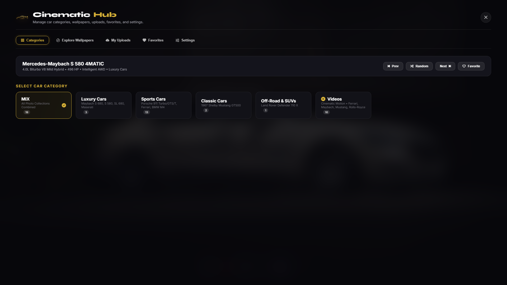

<p align="center">
  
</p>

# Cinematic New Tab - Car Wallpapers & App Dock

> A modern, high-performance automotive New Tab Chrome Extension featuring curated high-resolution car wallpapers, ambient widescreen video backgrounds, a transparent search bar, customizable app shortcut dock, and client-side image acceleration.

---

## 1. Project Title

**Cinematic New Tab - Car Wallpapers & App Dock**  
*(Google Chrome Extension — Manifest V3)*

---

## 2. About the Project

Standard browser new tab pages are often cluttered with distracting news feeds, sponsored links, and heavy widgets. **Cinematic New Tab** replaces that clutter with a clean, high-performance automotive experience. 

It provides an aesthetic, distraction-free dashboard centered on iconic sports cars, luxury grand tourers, classic muscle cars, rugged off-road vehicles, and ambient cinematic video motion, while retaining quick daily utility with a transparent search bar and application launcher.

---

## 3. What Does This Extension Do?

When you open a new tab in Google Chrome, the extension replaces the default blank or news-heavy tab with:
- **Cinematic Photography & Videos:** Displays curated high-res automotive photography and smooth 16:9 ambient video backgrounds that fit your screen cleanly.
- **Fast Google Search:** Provides an unobtrusive, transparent search bar that supports Google queries, direct website URLs, and voice input.
- **Custom App Launcher Dock:** Keeps your favorite websites within a single click at the bottom of the screen with official brand icons.
- **Zero Distractions:** Only the car wallpaper or video, search bar, and dock are visible on the main screen. Settings, display modes, and galleries are housed inside a slide-over hub.
- **Category Persistence:** Automatically remembers your active category (including Videos) across tab reloads and browser restarts.

---

## 4. Key Features

### Curated Automotive Wallpapers & Motion Backgrounds
- Curated high-resolution car media organized across distinct, strictly separated categories:
  - **Luxury Cars:** Mercedes-Maybach S 580 4MATIC, Mercedes-Maybach SL 680 Monogram, and Maserati GranTurismo Trofeo.
  - **Sports Cars:** Porsche 911 Turbo S, Carrera GTS, Carrera T, Porsche 911 GT3 Alpine Snow, Porsche 911 Sport Classic (Front & Profile Views), Ferrari F8 Tributo, Portofino M, Ferrari SF90 Stradale, Audi R8 V10 Performance, Mercedes-Benz SLS AMG Gullwing, BMW M4 Convertible, and BMW M4 Competition G82 Green.
  - **Classic Cars:** 1967 Shelby Mustang GT500 and 1965 Shelby Mustang GT350.
  - **Off-Road & SUVs:** Land Rover Defender 110 X.
  - **Cinematic Videos (Dedicated Category):** 100% widescreen 16:9 ambient motion backgrounds with audio stripped for silent, non-intrusive tab viewing:
    - *Ferrari 812 Superfast*
    - *Ford Mustang GT Drift*
    - *Rolls-Royce Heritage Classic & Modern*
    - *Mercedes-AMG GT Mountain Pass*
    - *Ferrari F40 Heritage Masterpiece*
    - *Mercedes-Benz 300 SL Gullwing*
    - *1969 Ford Mustang Fastback*
    - *Rolls-Royce Ghost Black Badge*
    - *Chevrolet Corvette C8 Stingray*
    - *Porsche Mission S Hypercar Concept*
  - **MIX Category:** Automatically aggregates all still photo categories into one continuous rotation. Videos are strictly isolated in their own category to prevent unintentional still/video mixing.

### Flexible Category Display Modes
Each category has its own independent display mode:
- **Sequence Mode (Default):** Cycles wallpapers in consistent order and loops smoothly from the beginning.
- **Shuffle Mode:** Randomizes the display sequence without repeating recent images during a cycle.
- **Single Image / Video Mode:** Locks the display to a specific car wallpaper or ambient video chosen from an interactive thumbnail selector.
- **Configurable Auto-Rotation:** Set wallpaper rotation to 10 seconds, 30 seconds, 1 minute, 5 minutes, 15 minutes, or disable timer rotation.

### Client-Side Image Acceleration & Optimization
- **Zero-Stutter Transitions:** Built-in `ImageOptimizer` uses `HTMLImageElement.decode()` to pre-decode upcoming images into GPU memory before rendering, preventing blank flashes.
- **WebP Compression:** Large source images are dynamically scaled and compressed into efficient WebP blobs stored in a client-side IndexedDB cache (`optimized_cache`).
- **Predictive Preloading:** Automatically preloads the upcoming image based on your active mode (Sequence next or Shuffle candidate).

### Safe Deleted Item Handling & Cache Busting
- Discontinued or purged assets are permanently wiped from disk, registries, IndexedDB caches, and favorites.
- Automated cache migration cleans obsolete entries on startup so removed cars never reappear.

### Personal Custom Uploads (IndexedDB)
- Drop or browse personal car photos (`.jpg`, `.jpeg`, `.png`, `.webp`) from your computer.
- Store custom wallpapers completely offline in local browser `IndexedDB`.
- Categorize custom uploads into any of the supported categories.

### Wallpaper Favorites
- Press `F` on your keyboard or click the heart button to bookmark any wallpaper.
- Dedicated Favorites gallery allows quick viewing and one-click application of saved favorites.

### Desktop-Style App Shortcut Dock
- Centered floating application dock with 100% transparent backgrounds.
- Pre-configured with official branding for **Gmail**, **YouTube**, **GitHub**, **X**, and **Instagram**.
- Add custom shortcuts with automatic domain favicon fetching.
- Drag-and-drop shortcut reordering.
- Click to select and delete shortcuts with a single action.

### Transparent Search Bar
- 100% transparent search bar floating directly over the wallpaper or video.
- Dual-mode input: Search Google or enter direct web URLs (`github.com`, `localhost:3000`).
- Press `/` from anywhere on the new tab to instantly focus the search input.
- Voice search supported via the Web Speech API.

---

## 5. Screenshots

### New Tab Homepage (Main Dashboard)
<p align="center">
  
</p>

*Cinematic New Tab homepage featuring the transparent search bar, floating application dock, and high-resolution automotive backdrop.*

### Cinematic Hub & Category Selector
<p align="center">
  
</p>

*Slide-over Cinematic Hub featuring category switching (Luxury, Sports, Classic, Off-Road, Videos, MIX), display mode toggles, and quick navigation actions.*

### Explore Gallery & Video Backgrounds
<p align="center">
  
</p>

*Explore Gallery showcasing the dedicated Videos category with live 16:9 previews, technical engine specs, and camera metadata.*

### Settings & Configuration Engine
<p align="center">
  
</p>

*Settings panel allowing granular control over display modes, rotation intervals, video fit modes, and storage management.*

---

## 6. Recent Updates & Improvements

- **Dedicated Videos Category:** Built a standalone ambient video engine supporting 10 cinematic automotive motion backgrounds.
- **16:9 Landscape Video Reframing:** Reframed all portrait/vertical videos to standard 16:9 widescreen landscape with smart visual composition.
- **Audio Stripping (`-an`):** Removed all audio tracks from video assets for silent, non-intrusive ambient background playback in Chrome.
- **Video Thumbnails:** Extracted crisp, dedicated thumbnail frames (`_thumb.jpg`) for seamless rendering in the Hub and Explore gallery.
- **Strict Video / MIX Isolation:** Ensured the MIX category strictly serves still wallpapers, completely separating videos into their own category.
- **Category Persistence:** Resolved state reset bugs so refreshing a tab or opening a new window retains the exact category previously selected.
- **Purged Outdated Assets:** Permanently cleaned disk files and IndexedDB caches for discontinued models.
- **Manifest V3 Full CSP Compliance:** Eliminated inline event handlers (`onclick`) across all modals for robust Chrome Web Store compliance.

---

## 7. Technologies Used

- **HTML5 & Modern CSS3:** Custom responsive layout, CSS Grid, Flexbox, and CSS Transitions.
- **Pure Vanilla JavaScript (ES6+):** Zero external frontend frameworks or heavy runtime dependencies.
- **Google Chrome Extensions Manifest V3:** Standard compliant configuration using non-persistent background execution.
- **Chrome Storage API (`chrome.storage.local`):** Fast local storage for shortcuts, settings, favorites, and state tracking.
- **IndexedDB API (`ApexCinemaDB`):** Persistent offline storage engine for custom user wallpaper uploads and optimized WebP display caches.
- **HTML5 Canvas & OffscreenCanvas API:** High-speed client-side image compression and aspect-ratio preservation.
- **Bootstrap Icons (v1.11.3) & Font Awesome 6:** Vector iconography for navigation tabs, search controls, and dock actions.
- **Web Speech API:** Browser-native speech recognition for voice search.

---

## 8. Installation Guide

Follow these steps to run the extension locally in Google Chrome:

1. **Clone or Download the Repository:**
   ```bash
   git clone https://github.com/sahravikishan/car-chrome-extension.git
   ```
   *(Or download and extract the ZIP file to your local computer).*

2. **Open Chrome Extensions Page:**
   - In Google Chrome, type `chrome://extensions/` in the address bar and press Enter.
   - Alternatively, open the Chrome menu (`⋮`) → **Extensions** → **Manage Extensions**.

3. **Enable Developer Mode:**
   - In the top-right corner of the Extensions page, toggle the **Developer mode** switch to **ON**.

4. **Load the Extension:**
   - Click the **Load unpacked** button in the top-left toolbar.
   - In the file picker, select the project directory containing `manifest.json`.

5. **Open a New Tab:**
   - Press `Ctrl + T` (or `Cmd + T` on macOS) to launch your new tab page.

---

## 9. How to Use

### Basic Navigation & Hotkeys
| Key | Action |
|---|---|
| `/` | Instantly focus the search bar |
| `→` (Right Arrow) | Advance to the next wallpaper or video |
| `←` (Left Arrow) | Return to the previous wallpaper or video |
| `Space` | Show a random wallpaper/video from the active category |
| `F` | Toggle Favorite on current wallpaper |
| `M` or `S` | Open or close the Cinematic Hub menu |
| `Esc` | Close any open modal or blur the search bar |

### Accessing the Hub Modal
- Click the menu icon (`☰`) in the top-right corner to open the **Cinematic Hub**.
- From the Hub, you can:
  - Switch active categories (`Luxury Cars`, `Sports Cars`, `Classic Cars`, `Off-Road & SUVs`, `Videos`, `MIX`).
  - Explore all registered wallpapers and videos in the gallery.
  - Upload personal images in the **My Uploads** tab.
  - View bookmarked images in the **Favorites** tab.
  - Customize auto-rotation intervals, display modes, wallpaper fit mode, and icon sizes in **Settings**.

### Managing App Shortcuts
- **Add Shortcut:** Click the `+` button on the dock, enter the website name and URL, and click **Save Shortcut**.
- **Reorder:** Click and drag any shortcut horizontally along the dock.
- **Remove Shortcut:** Click any shortcut once to select it, then click the red `×` badge to delete it.
- **Launch:** Click any shortcut icon to navigate to the website.

---

## 10. Project Structure

```text
├── manifest.json              # Chrome Extension Manifest V3 configuration
├── newtab.html                # Main New Tab document
├── README.md                  # Project documentation and guide
├── WALLPAPER_MANAGEMENT.md    # Developer guide for adding & managing wallpapers
├── .gitignore                 # Files excluded from Git tracking
├── .env.example               # Template environment configuration (offline project)
├── docs/
│   └── screenshots/           # Extension interface screenshots
│       ├── homepage.png       # 1080p full New Tab homepage preview
│       ├── hub_categories.png # Hub overlay with category selection
│       ├── hub_explore_videos.png # Explore gallery showing video backgrounds
│       └── hub_settings.png   # Settings panel and display mode controls
├── css/
│   └── cinematic.css          # Design system, transparent search bar & dock styles
├── js/
│   ├── app.js                 # UI controllers, shortcuts, dock, and Hub interactions
│   ├── db.js                  # IndexedDB database manager for custom uploads & caches
│   ├── imageOptimizer.js      # Client-side WebP compressor, pre-decoder, and LRU cache
│   ├── storage.js             # chrome.storage.local wrapper for settings and favorites
│   ├── wallpapers.js          # Central registry array for verified built-in wallpapers & videos
│   └── wallpaperService.js    # Reactive service for category management and subscriptions
├── assets/
│   ├── icons/                 # Extension toolbar and application brand icons
│   │   ├── logo.png           # Transparent 24K Golden Apex logo (1024x1024)
│   │   ├── icon16.png         # Extension toolbar icon (16x16 transparent)
│   │   ├── icon48.png         # Extension management icon (48x48 transparent)
│   │   ├── icon128.png        # Chrome Web Store & details icon (128x128 transparent)
│   │   ├── gmail.svg          # Official Google Workspace Gmail vector
│   │   ├── youtube.svg        # Official YouTube vector
│   │   ├── github.svg         # Official GitHub vector
│   │   ├── x.svg              # Official X vector
│   │   └── instagram.svg      # Official Instagram vector
│   ├── videos/                # Ambient 16:9 cinematic video backgrounds
│   │   ├── *.mp4              # Muted H.264 video loops (Ferrari, Porsche, Mustang, Corvette, etc.)
│   │   └── *_thumb.jpg        # High-res video preview thumbnails for UI galleries
│   └── wallpapers/            # High-resolution automotive wallpapers
│       ├── luxury/            # Luxury car wallpapers
│       ├── sports/            # Sports car wallpapers
│       ├── classic/           # Classic car wallpapers
│       ├── offroad/           # Off-Road & SUV wallpapers
│       └── mixup/             # Curated mixed copies for rapid rotation
└── scripts/                   # Developer automation and sync utilities
    ├── add_wallpaper.py       # Helper script to validate and register new wallpapers
    ├── image_sync_manager.py  # Image synchronization and deduplication utility
    └── sync_wallpapers.py     # Script to sync images across category folders
```

---

## 11. Privacy and Data Storage

- **100% Local and Offline:** The extension requires no external accounts, servers, or user tracking.
- **No Analytics or Telemetry:** No personal data, search queries, or browsing history are ever collected, transmitted, or logged.
- **Browser-Local Storage:**
  - Shortcuts, category display mode preferences, favorites, and settings are saved locally using Chrome's secure `chrome.storage.local` API.
  - Personal wallpaper uploads and display caches are saved strictly inside your local browser's `IndexedDB` sandbox.
- **Network Requests:** The extension makes network requests only when:
  - You submit a search query (redirects directly to Google Search).
  - You click an application shortcut or enter a URL in the address/search bar.
  - You add a custom shortcut without an icon, in which case Google Favicon API is queried to fetch the domain's icon.
  - Loading web fonts and vector icons (Google Fonts and Bootstrap Icons via CDN).

---

## 12. License

This project is currently distributed for personal use. If you plan to fork, redistribute, or use this code commercially, consider adding an appropriate open-source license (such as the MIT License) to the repository.
